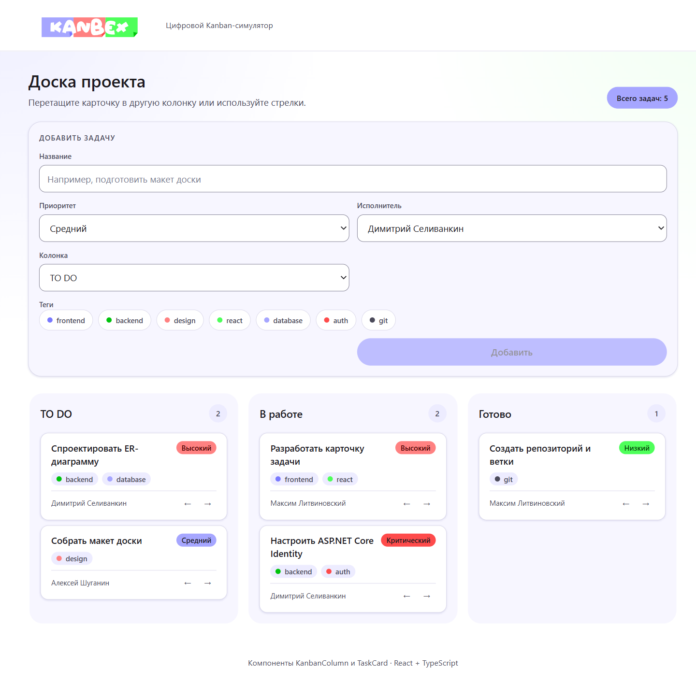
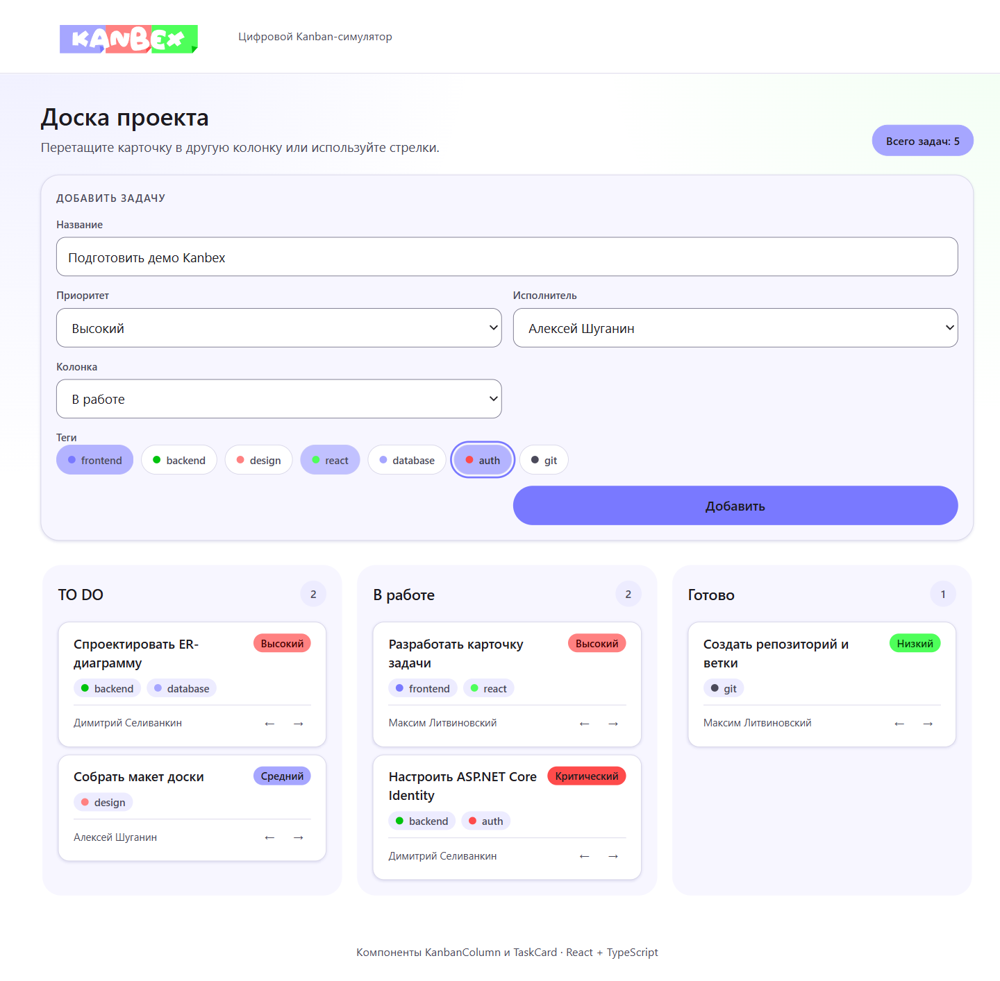
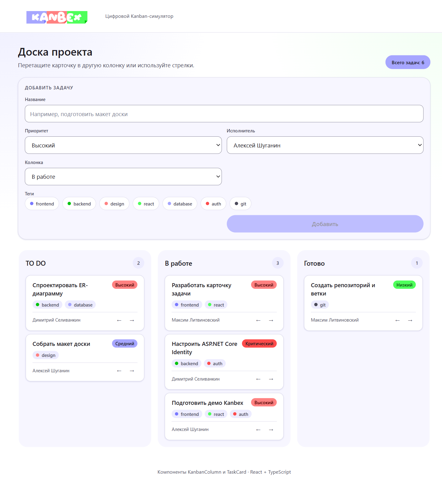

# KANBEX — React-библиотека компонентов Kanban-доски

Учебный проект лабораторной работы №4: библиотека UI-компонентов и демонстрационное приложение Kanban-доски\.

## Описание проекта

Решение состоит из двух независимых React-проектов:

- `ui-library` — библиотека компонентов `KanbanColumn` и `TaskCard`, а также вспомогательных `Card` и `Button`;
- `frontend` — демонстрационное приложение с Kanban-доской, drag-and-drop, перемещением задач стрелками и формой добавления задачи.

Доска содержит три колонки: `TO DO`, `В работе` и `Готово`. Задачи можно перетаскивать между колонками или перемещать кнопками `←` и `→`. При добавлении задачи выбираются название, приоритет, исполнитель, целевая колонка и теги из мок-данных.

Оформление построено на палитре логотипа Kanbex:

- фиолетовый — `#7979FF`, `#A6A6FF`;
- зелёный — `#00C30D`, `#4EFF5A`;
- красный — `#FE4B4B`, `#FF8181`;
- белый — `#FFFFFF`.

## Скриншоты

### Общий вид доски



### Форма добавления задачи с выбранными тегами



### Добавленная задача в колонке «В работе»



## Возможности

- Три колонки с количеством задач и пустым состоянием.
- Карточки задач с приоритетом, тегами и исполнителем.
- Перемещение задач между колонками с помощью HTML5 Drag and Drop.
- Перемещение задач кнопками `←` и `→` как альтернатива для тач-устройств.
- Добавление новой задачи с выбором приоритета, исполнителя, колонки и нескольких тегов.
- Сброс формы после добавления задачи.
- Адаптивная вёрстка для узких экранов.
- Оформление в стиле Material Design 3 с токенами темы.


## Технологии

- React 19
- TypeScript
- Vite
- CSS Modules
- Jest
- Testing Library
- ESLint

## Запуск проекта

Требуется Node.js 20.19+ и npm.

### 1. Сборка библиотеки компонентов

```sh
cd lab4-react/solutions/student-24/ui-library
npm install
npm run build
```

### 2. Запуск демонстрационного приложения

```sh
cd ../frontend
npm install
npm run dev
```

После запуска приложение доступно по адресу:

```text
http://localhost:5173
```

Если после изменения компонентов библиотеки демо-приложение продолжает показывать старую версию, пересоберите библиотеку:

```sh
cd ../ui-library
npm run build
```

## Скрипты

### `ui-library`

| Команда | Назначение |
| --- | --- |
| `npm run dev` | Сборка библиотеки в режиме наблюдения |
| `npm run build` | Сборка библиотеки и деклараций TypeScript |
| `npm run lint` | Проверка кода ESLint |
| `npm run test` | Запуск тестов |
| `npm run test:coverage` | Запуск тестов с отчётом покрытия |

### `frontend`

| Команда | Назначение |
| --- | --- |
| `npm run dev` | Запуск Vite dev-сервера |
| `npm run build` | Production-сборка |
| `npm run preview` | Просмотр production-сборки |
| `npm run lint` | Проверка кода ESLint |
| `npm test` | Запуск тестов |
| `npm run test:coverage` | Запуск тестов с отчётом покрытия |

## Компоненты библиотеки

### `KanbanColumn`

Принимает колонку с задачами, обрабатывает drag-and-drop и отображает счётчик задач.

```ts
interface KanbanColumnProps {
  column: Column
  onDropTask: (taskId: string) => void
  onMoveTask: (taskId: string, direction: 'left' | 'right') => void
}
```

### `TaskCard`

Отображает задачу, её приоритет, теги, исполнителя и кнопки перемещения.

```ts
interface TaskCardProps {
  task: Task
  onMove: (direction: 'left' | 'right') => void
}
```

### Модель данных

```ts
type Priority = 'low' | 'medium' | 'high' | 'critical'

interface Tag {
  id: string
  name: string
  color: string
}

interface User {
  id: string
  displayName: string
}

interface Task {
  id: string
  title: string
  priority: Priority
  tags: Tag[]
  assignee?: User
}

interface Column {
  id: string
  title: string
  tasks: Task[]
}
```

## Тестирование

В проекте используются Jest и Testing Library.

```sh
cd lab4-react/solutions/student-24/ui-library
npm run test:coverage

cd ../frontend
npm run test:coverage
```

Текущие результаты:

- `ui-library` — 25 тестов, покрытие 100% по statements, branches, functions и lines;
- `frontend` — 9 тестов, покрытие `98.71%` statements, `95%` branches, `100%` functions и `98.66%` lines.

В обоих проектах настроен минимальный порог покрытия 90%.

